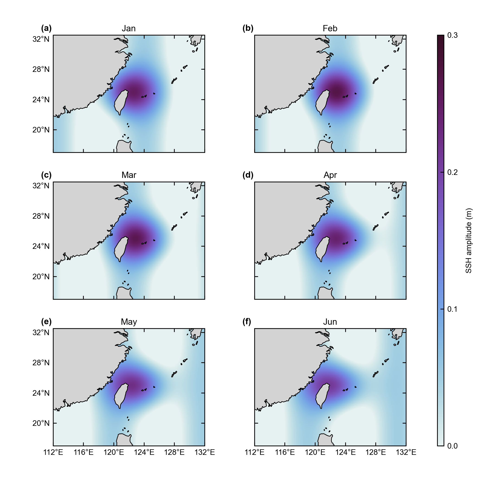
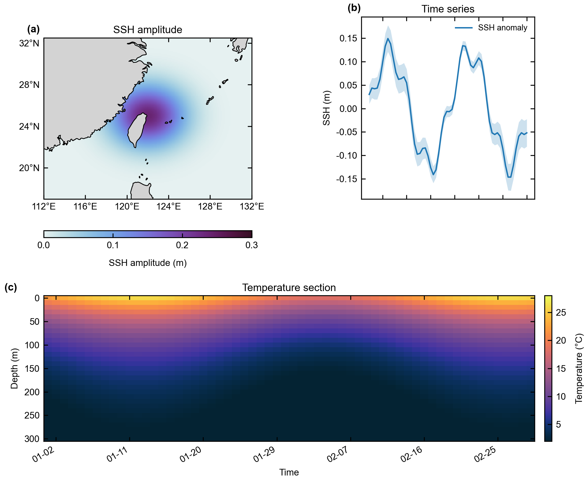

# Oceanography Plotting Style

**中文** | [English](README.en.md)

> 物理海洋学论文图的“可复用绘图规范 + 代码工具箱”。既是 DeepSeek Harness / Agent Skill，也是一个可单独安装的 Python 小包。

[](https://github.com/Char0nChengg/oceanography-plotting-style/actions/workflows/ci.yml)
[](https://www.python.org/)
[](LICENSE)

---

## 这是什么？

做海洋学论文图时，真正花时间的通常不是 `pcolormesh`，而是这些反复出现的问题：

- 经纬度顺序反了、1D/2D 坐标广播错了；
- 0–360° 和 −180–180° 混用，跨日界线图断裂；
- 色标 `extend` 和实际数据范围不一致；
- 多面板字号在最终印刷宽度下小得看不清；
- 地图被 `set_aspect("auto")` 拉扁；
- 10m 海岸线让 PDF 变成几十 MB；
- 时间轴跨年却还在用 `%m-%d`；
- 图能跑，但标签被裁、刻度重叠、色标没有单位。

这个项目把上述经验固化成一套 **可被 Agent 加载的 Skill**，同时提供可导入的 Python 工具、可运行的模板、测试和 CI。目标不是“画出来”，而是**能直接放进论文**。

English introduction: [README.en.md](README.en.md) — a reusable Agent Skill and Python toolkit for publication-quality physical-oceanography figures with Matplotlib, Cartopy and cmocean.

---

## 设计立场

本项目的所有绘图风格都按作者的个人偏好设计，不是期刊官方模板。不同作者、期刊和审稿人有各自的视觉传统；有些常见的投稿图把较多注意力放在装饰、饱和度或层层堆叠的文字上，反而削弱了数据本身的可读性。本项目选择更克制、信息密度更高的表达，但不评判其他作者，投稿时仍以目标期刊最新指南为准。

- **只用 cmocean 色标**：不用 jet/rainbow；根据变量属性选择顺序、发散或循环色标。
- **图优先、文字克制**：没有整张图的主标题，只有子图副标题和 `(a)`/`(b)` 面板字母；能共享的横纵坐标就共享。
- **Colorbar 清晰但不占主图**：优先外置列、图下横条或 inset，必要时使用分段/拼接色标；刻度 4–7 个，`extend` 必须诚实。
- **分析图同源**：CCA、小波、谱分析、EMD 等也采用同一套作者风格；这些做法已在作者本人的投稿与返修中使用，并接受过期刊编辑与审稿流程的检验。后续计划整理由问题驱动的海洋/大气统计分析教程。

完整说明见 [设计立场](docs/style-philosophy.md)。这是一套可重复、可检查的个人工作流，不是唯一的正确审美。

---

## 示例

3×2 区域地图（合成数据，仅演示版式与色标）：



地图 + 时间序列 + 垂向剖面（合成数据）：



> 模板默认使用 `50m` 海岸线以控制 PDF 体积；单张大图可切到 `10m`。所有模板都要求显式 `--demo` 才会运行，避免把合成图误当结果图。

---

## 主要能力

| 能力 | 说明 |
|---|---|
| 区域地图 | PlateCarree、经纬度 formatter、自适应刻度、陆地/海岸线、比例保护 |
| 多面板版式 | 共用色标、内侧标签隐藏、面板字母、GridSpec / 显式 colorbar 列 |
| 垂向剖面 / Hovmöller | 深度方向、时间轴、对称/非对称色标、转置校验 |
| 时间序列 | 均值 ± 标准差、滚动统计、自动时间 locator |
| FFT | 去趋势、窗函数、单边振幅谱、AR(1) 红噪声 Monte-Carlo 阈值 |
| Quiver | 按版面英寸控制箭头长度、`quiverkey`、按密度取 stride |
| 色标 | cmocean 映射、`TwoSlopeNorm`、`LogNorm`、`BoundaryNorm`、色标截取 |
| 数据准备 | xarray 维度统一、区域裁剪、跨日界线、降序纬度、2D 坐标 |
| 期刊预设 | AGU / AMS / Elsevier / Nature / generic 的栏宽与字号 |
| 出图 QA | 刻度重叠检测、画布越界检查、色盲/灰度近似筛查 |
| 可复现 | `--self-test`、pytest、GitHub Actions、依赖文件 |

---

## 安装

### 方式 A：作为 DSH / Agent Skill

DSH 通过目录发现 skill，**不是** `dsh plugin add`：

```text
<project>/.dsh/skills/oceanography-plotting-style/SKILL.md
```

或全局：

```text
~/.dsh/skills/oceanography-plotting-style/SKILL.md
```

把本仓库克隆/复制到上述目录即可。`SKILL.md` 在仓库根目录，所以可以直接把仓库目录作为 skill 目录。

```bash
git clone https://github.com/Char0nChengg/oceanography-plotting-style.git \
  .dsh/skills/oceanography-plotting-style
```

加载后可用 `/oceanography-plotting-style` 调用（具体命令取决于客户端），模型也会根据 `description` 自动路由。

### 方式 B：作为 Python 包

```bash
python -m pip install -e ".[full]"
```

最小依赖（只有 `ocean_plot` 的基础功能）：

```bash
python -m pip install -e .
```

Cartopy 在 Windows 上建议用 conda：

```bash
conda env create -f environment.yml
conda activate oceanography-plotting-style
```

---

## 快速开始

下面的例子使用 `.[full]` 依赖（Cartopy、cmocean、xarray）。

```python
from pathlib import Path

import matplotlib
matplotlib.use("Agg")
import matplotlib.pyplot as plt
import cartopy.crs as ccrs

from ocean_data import grid_arrays, load_for_plot
from ocean_plot import (
    add_map_features, add_panel_label, auto_tick_step, check_figure,
    get_cmap, save_figure, set_degree_ticks, set_ocean_style, validate_grid,
)
from ocean_journal import get_journal, apply_journal_style

journal = get_journal("agu")
set_ocean_style(base_size=journal.body_pt)
apply_journal_style(journal.key)   # 顺序不能反：覆盖 journal 线宽

lon_min, lon_max = 112.0, 132.0
lat_min, lat_max = 17.0, 32.5
fig_width = journal.width_in("double")

# 换成你的文件；地图这里显式取第一帧
da = load_for_plot(
    "data/ssh.nc", "ssh",
    region={"lon": (lon_min, lon_max), "lat": (lat_min, lat_max)},
)
frame = da.isel(time=0) if "time" in da.dims else da
lon, lat, ssh = grid_arrays(frame)
validate_grid(lon, lat, ssh)

fig, ax = plt.subplots(
    figsize=(fig_width, 4.8),
    subplot_kw={"projection": ccrs.PlateCarree()},
    constrained_layout=True,
)
projection = ccrs.PlateCarree()
mesh = ax.pcolormesh(
    lon, lat, ssh, cmap=get_cmap("cmo.dense"),
    vmin=0, vmax=0.3, shading="auto",
    transform=projection, rasterized=True,
)
ax.set_extent([lon_min, lon_max, lat_min, lat_max], crs=projection)
add_map_features(ax, scale="50m")
step_x, step_y = auto_tick_step(
    lon_min, lon_max, lat_min, lat_max,
    figsize=(fig_width, 4.8), fontsize=journal.tick_pt,
)
set_degree_ticks(ax, [lon_min, lon_max, lat_min, lat_max],
                 lon_step=step_x, lat_step=step_y)
ax.set_aspect("equal")
add_panel_label(ax, "(a)")

cbar = fig.colorbar(mesh, ax=ax, extend="neither")
cbar.set_label("SSH amplitude (m)")

for issue in check_figure(fig, check_bounds=True):
    print("layout warning:", issue)
save_figure(
    fig, Path("figures/Fig_01.png"), dpi=journal.dpi,
    also_pdf=True, tight=False,
)
```

> 上面的片段默认存在 `data/ssh.nc`，并显式取第一帧；请换成自己的文件和时间选择。模板版见 `templates/map_panel_grid.py`。

---

## 运行模板

```bash
# 3×2 地图
python templates/map_panel_grid.py --demo

# 地图 + 时间序列 + 垂向剖面
python templates/mixed_panel_grid.py --demo
```

不带 `--demo` 会直接退出，提醒你替换合成数据。

---

## 数据准备

```python
from ocean_data import canonicalize_dims, subset_region, pick_var, grid_arrays

ds = canonicalize_dims(ds)
ds = subset_region(ds, lon_bounds=(112, 132), lat_bounds=(17, 32.5))
da = pick_var(ds, "ssh")
lon, lat, data = grid_arrays(da)
```

- 支持 1D 规则经纬度和 2D 曲线经纬度，`grid_arrays()` 不要求坐标名等于维度名；
- 1D 跨日界线/负经度会返回单调展开的 0–360° 坐标（可能 >360），需配 `central_longitude=180` 或等价投影；
- 2D 曲线坐标只做布尔掩膜，保留原生坐标，不会 unwrap 或排序；
- 全图范围 `(-180, 180)` / `(0, 360)` 不会裁掉经度；
- `load_for_plot()` 默认保留时间维，不会静默 `isel(time=0)`。

---

## 谱分析

```python
from ocean_spectral import fft_amplitude, ar1_threshold, dominant_period

freq, amp = fft_amplitude(x, dt=1.0, detrend="linear", window="hann")
result = ar1_threshold(x, dt=1.0, confidence=0.95, n_sim=500, seed=0)
period = dominant_period(freq, amp)
```

AR(1) 阈值是一个明确的零假设检验：先拟合红噪声，再做 Monte-Carlo 模拟。它不是万能的显著性检验，方法部分要写清楚。

---

## 色标与可访问性

```python
from ocean_access import accessibility_report

report = accessibility_report("cmo.balance")
print(report["warnings"])
```

- 灰度亮度间隔检查；
- 近似 deuteranopia / protanopia 模拟；
- 结果是筛查，不是无障碍认证。

---

## 期刊预设

| key | 适用 | 单栏 | 双栏 | 正文字号 |
|---|---|---:|---:|---:|
| `generic` | 通用 | 89 mm | 183 mm | 8 pt |
| `agu` | AGU / JGR / GRL | 89 mm | 180 mm | 8 pt |
| `ams` | AMS | 85 mm | 178 mm | 8 pt |
| `elsevier` | Elsevier | 90 mm | 190 mm | 8 pt |
| `nature` | Nature 系列 | 89 mm | 183 mm | 6 pt |

这些是**作者实践中的实用默认值**，不是期刊官方模板；不同期刊、不同年份的指南会变化（例如 Nature 的 6 pt），投稿前必须核对最新 author guidelines。

```python
from ocean_journal import get_journal, figure_size, apply_journal_style

style = get_journal("ams")
w, h = figure_size("ams", "double", height_mm=200)
apply_journal_style("ams")
```

---

## 项目结构

```text
.
├── SKILL.md                  # Agent Skill 入口
├── README.md                 # 中文介绍
├── README.en.md              # English introduction
├── CHANGELOG.md
├── references/
│   ├── style-reference.md    # 字体、版面、地图、色标、验收
│   ├── data-prep.md          # xarray、区域、经度、滤波
│   └── figure-recipes.md     # Hovmöller、剖面、FFT、quiver
├── scripts/
│   ├── ocean_plot.py         # 刻度、地图、色标、QA、保存
│   ├── ocean_data.py         # 维度统一、区域裁剪、变量选择
│   ├── ocean_spectral.py     # FFT + AR(1) 阈值
│   ├── ocean_journal.py      # 期刊预设
│   └── ocean_access.py       # 灰度/CVD 筛查
├── templates/
│   ├── map_panel_grid.py
│   └── mixed_panel_grid.py
├── tests/
├── docs/
│   ├── style-philosophy.md   # 设计立场（中文）
│   ├── style-philosophy.en.md
│   └── assets/
└── .github/workflows/
    ├── ci.yml
    └── release.yml
```

---

## 测试与验证

```bash
python scripts/ocean_plot.py --self-test
python -m pytest -q
```

已在以下环境实际渲染验证：

- Python 3.13.9（Anaconda base）
- Matplotlib 3.10.6
- Cartopy 0.25.0
- cmocean 3.0.3
- xarray 2025.10.1 / scipy 1.16.3 / pandas 2.3.3

CI 在 Ubuntu + Python 3.10/3.12/3.13 上安装 Cartopy，运行测试、self-test、两个模板，并构建/检查 wheel 与 sdist。

---

## 已知边界

- 主要支持规则 1D 和 2D 曲线经纬度；**不直接支持** ROMS 交错网格、非结构三角网格、投影坐标（m/km）的自动转换。
- 期刊栏宽/字号是经验值，不能替代最新投稿指南。
- `auto_tick_step()` 仍是启发式；`check_figure()` 会抓实际刻度重叠，但不做图像 diff。
- `set_degree_ticks()` 只支持 PlateCarree/Mercator 等矩形投影；LCC/Robinson 等请用 `gridlines(draw_labels=True)`。
- CVD 矩阵是近似；正式投稿前建议用专用工具复核。
- AR(1) 阈值只有一个红噪声零假设；复杂谱峰需问题特定的检验。
- Natural Earth 数据首次使用会下载；离线环境需提前缓存。
- 模板数据全部是合成的，必须替换；`--demo` 是防误用开关。
- `pip install` 安装的是 Python 模块；`SKILL.md`、`references/` 和 `templates/` 通过仓库/skill 目录分发，不进入 wheel。
- `tight=True` 会改变成品物理尺寸；论文交付使用 `tight=False` 并在保存前做画布检查。

---

## 贡献

欢迎提交 issue / PR，尤其是：

- 新的期刊预设；
- 非结构网格或投影坐标示例；
- 真实数据（可公开）的端到端示例；
- 视觉回归基线。

请确保 `python -m pytest -q` 通过，并附上渲染后的 PNG。

---

## License

MIT。见 [LICENSE](LICENSE)。版本历史见 [CHANGELOG.md](CHANGELOG.md)。

## 引用

如果这个项目帮到了你的论文，可以在方法/致谢中提及：

> Figures were prepared with the `oceanography-plotting-style` toolkit (Char0nChengg, 2026), built on Matplotlib, Cartopy and cmocean.
